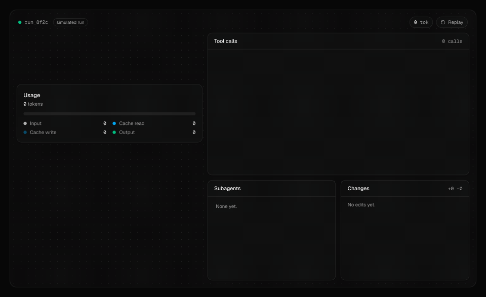
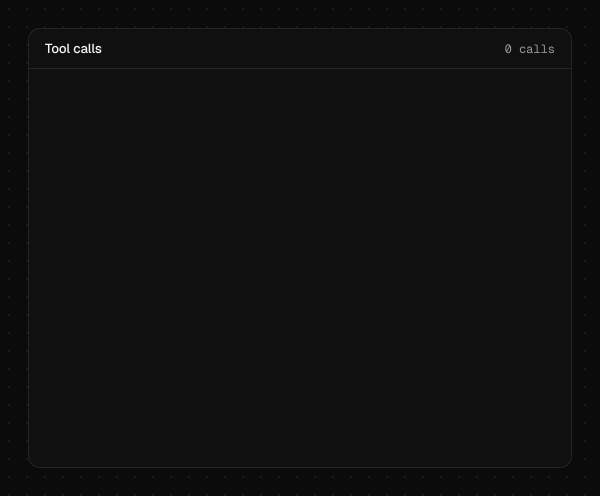
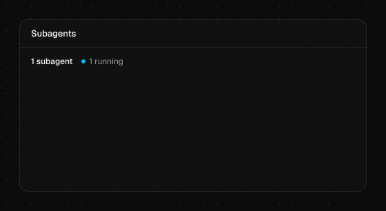
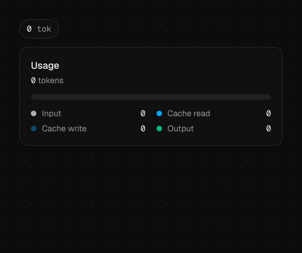
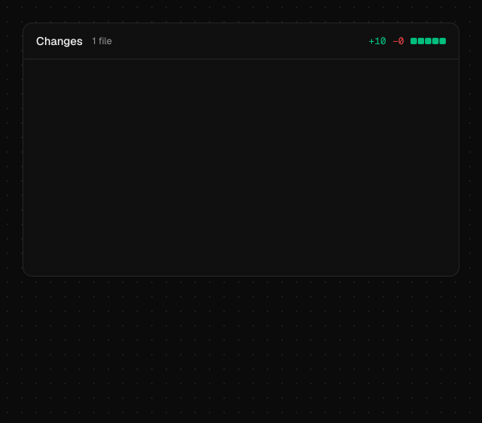

<p align="center">
  <a href="https://cig13zs.github.io/agent-ui/"></a>
</p>

# agent-ui

[](https://ko-fi.com/jju1s)
[](LICENSE)
[](https://github.com/cig13zs/agent-ui/actions/workflows/ci.yml)

React components for the part of an agent app people sit and watch: the current step, the tool calls, the approvals, the subagents, the bill and the diff.

[Live demo](https://cig13zs.github.io/agent-ui/) · [Components](#components) · [Event schema](#event-schema) · [Adapters](#adapters)

Chat kits already cover messages and prompt boxes. agent-ui covers the run itself, the long stretch after you hit enter where the agent reads files, calls tools, asks permission and spends tokens. The components install through the shadcn CLI as plain source files, so you own and edit them like the rest of your UI.

```sh
npx shadcn@latest add https://cig13zs.github.io/agent-ui/r/agent-ui.json
```

That adds all six components and the `useAgentRun` hook. Each piece also installs on its own (commands below). Runtime dependencies: `react` and `lucide-react`. Nothing else.

## Components

<table>
<tr>
<td width="50%" valign="top">

<h3>AgentRunCard</h3>
What the run is doing now, a live elapsed timer, the model, "Step 4 of 6" over a segmented bar, and the steps it already finished with their durations. States: running, paused, waiting for approval, done, failed. Pause, stop and open are callbacks.

<pre>npx shadcn@latest add https://cig13zs.github.io/agent-ui/r/agent-run-card.json</pre>
</td>
<td width="50%" valign="top">

<h3>ToolTimeline</h3>
Tool calls as they stream in, with an icon per kind (read, search, edit, run, web, subagent), live durations, rows that expand into their output, and an error state that opens itself.

<pre>npx shadcn@latest add https://cig13zs.github.io/agent-ui/r/tool-timeline.json</pre>
</td>
</tr>
<tr>
<td valign="top">

<h3>ApprovalPrompt</h3>
"Agent wants to run <code>rm -rf dist</code>" with Allow once, Always allow and Deny. Risk level sets the styling and the defaults: a high-risk command can't be always-allowed unless you opt in. Shows a command or a diff. Y, A and N answer it while focus is inside.

<pre>npx shadcn@latest add https://cig13zs.github.io/agent-ui/r/approval-prompt.json</pre>
</td>
<td valign="top">

<h3>SubagentTree</h3>
Parallel subagents and the ones they spawned, each with a status, what it is doing right now, tool count, tokens and a timer. A real ARIA tree: arrow keys move, left and right fold, Home and End jump.

<pre>npx shadcn@latest add https://cig13zs.github.io/agent-ui/r/subagent-tree.json</pre>
</td>
</tr>
<tr>
<td valign="top">

<h3>UsageMeter</h3>
Tokens in and out, the share served from cache, cost, and how much of a rate limit is gone with a live reset countdown. A compact pill for headers and an expanded card for side panels.

<pre>npx shadcn@latest add https://cig13zs.github.io/agent-ui/r/usage-meter.json</pre>
</td>
<td valign="top">

<h3>DiffSummary</h3>
Files the run changed, with added / modified / deleted / renamed badges, +/- counts and diffstat blocks. Click a row for the hunk with old and new line numbers.

<pre>npx shadcn@latest add https://cig13zs.github.io/agent-ui/r/diff-summary.json</pre>
</td>
</tr>
</table>

Every component:

- is one `.tsx` file styled with the standard shadcn tokens (`bg-card`, `text-muted-foreground`, `border-border`, `ring`), so it follows your theme and dark mode
- works with the keyboard, with visible focus rings and screen reader labels on every state
- stops spinning, sliding and shimmering when the OS asks for reduced motion (`motion-safe:` / `motion-reduce:`)
- takes `className` and passes other props through to its root element

## Wiring it to a run

Push events into `useAgentRun` and spread what comes out onto the components. The hook is a thin wrapper over a pure reducer (`reduceAgentRun`), so the same events can be stored, replayed or reduced on a server.

```sh
npx shadcn@latest add https://cig13zs.github.io/agent-ui/r/use-agent-run.json
```

```tsx
import { useEffect } from "react"
import { useAgentRun } from "@/hooks/use-agent-run"
import { AgentRunCard } from "@/components/agent-run-card"
import { ApprovalPrompt } from "@/components/approval-prompt"
import { ToolTimeline } from "@/components/tool-timeline"
import { SubagentTree } from "@/components/subagent-tree"
import { UsageMeter } from "@/components/usage-meter"
import { DiffSummary } from "@/components/diff-summary"

export function RunView({ runId }: { runId: string }) {
  const run = useAgentRun()
  const { dispatch } = run

  useEffect(() => {
    const source = new EventSource(`/api/runs/${runId}/events`)
    source.onmessage = (e) => dispatch(JSON.parse(e.data))
    return () => source.close()
  }, [runId, dispatch])

  return (
    <>
      <AgentRunCard {...run.card} onStop={() => fetch(`/api/runs/${runId}/stop`, { method: "POST" })}>
        {run.approval && (
          <ApprovalPrompt
            command={run.approval.command}
            diff={run.approval.diff}
            risk={run.approval.risk}
            reason={run.approval.reason}
            onDecision={(decision) => fetch(`/api/runs/${runId}/approvals/${run.approval!.id}`, { method: "POST", body: decision })}
          />
        )}
      </AgentRunCard>
      <ToolTimeline items={run.timeline} />
      <SubagentTree nodes={run.subagents} />
      <UsageMeter {...run.usage} />
      <DiffSummary files={run.files} />
    </>
  )
}
```

`useAgentRun()` returns `state`, `dispatch` (one event or an array), `reset`, `consume(asyncIterable)` and ready-made props: `card`, `timeline`, `approval`, `subagents`, `usage`, `files`. Pass `useAgentRun({ events })` instead when you derive the whole event list from something else on each render, as the AI SDK adapter does.

The components don't need the hook. They take plain props, so you can feed them from your own store.

## Event schema

Small JSON objects with a `type`. Every event takes an optional `at` (epoch ms); missing times are stamped when the hook first sees the event.

| type | fields |
| --- | --- |
| `run.start` | `title?` `model?` `totalSteps?` `runId?` |
| `run.pause`, `run.resume` | |
| `run.end` | `status?: "done" \| "failed"` `error?` |
| `step.start` | `label` `kind?` `id?` |
| `step.end` | `summary?` `status?` `id?` |
| `tool.start` | `id` `title` `kind?` `target?` `name?` `input?` `subagentId?` |
| `tool.delta` | `id` `output` (appended) |
| `tool.end` | `id` `status?: "done" \| "error"` `output?` `error?` `summary?` |
| `approval.request` | `id` `command?` `diff?` `risk?: "low" \| "medium" \| "high"` `reason?` `cwd?` `title?` |
| `approval.resolve` | `id` `decision: "allow-once" \| "allow-always" \| "deny"` |
| `subagent.start` | `id` `name` `task?` `parentId?` |
| `subagent.update` | `id` `activity?` `tokens?` |
| `subagent.end` | `id` `status?` `summary?` |
| `usage` | `inputTokens?` `outputTokens?` `cacheReadTokens?` `cacheWriteTokens?` `costUsd?` `mode?: "add" \| "set"` |
| `limit` | `used` `max` `resetsAt?` `label?` |
| `file.change` | `path` `additions` `deletions` `status?` `diff?` |

`kind` is one of `read`, `search`, `edit`, `run`, `web`, `task`, `other` and picks the icon.

A few rules the reducer follows:

- Steps are optional. Without `step.*` events the card lists finished top-level tool calls instead and shows the running one as the current step.
- `step.start` closes the step before it. `step.end` with a `summary` replaces the label, so "Reading the billing module" can finish as "Read 12 files".
- An unanswered `approval.request` puts the run in `waiting-approval`; resolving it goes back to `running`.
- Time spent paused is taken off the elapsed timer.
- Tool calls with a `subagentId` count toward that subagent and stay out of the main timeline.
- `run.end` closes anything still running.

```json
{ "type": "tool.start", "id": "t7", "kind": "edit", "title": "Edit", "target": "src/billing/invoice.ts" }
{ "type": "file.change", "path": "src/billing/invoice.ts", "additions": 3, "deletions": 3, "diff": "@@ -38,6 +38,6 @@ ..." }
{ "type": "tool.end", "id": "t7", "output": "+3 −3" }
{ "type": "approval.request", "id": "a1", "command": "rm -rf dist", "risk": "high", "reason": "Stale build output" }
```

## Adapters

If you already stream tool calls from a model API, an adapter turns them into events. Each is one file with structural types, so none of them imports an SDK.

### Vercel AI SDK

```sh
npx shadcn@latest add https://cig13zs.github.io/agent-ui/r/agent-run-ai-sdk.json
```

```tsx
const { messages, status, stop } = useChat()
const adapter = useMemo(() => createAISDKAdapter({ model: "claude-opus-5-5" }), [])
const events = useMemo(() => adapter.toEvents(messages, status), [adapter, messages, status])
const run = useAgentRun({ events })

return <AgentRunCard {...run.card} onStop={stop} />
```

Tool parts (`tool-*` and `dynamic-tool`) become `tool.*` events, parts in `approval-requested` become approvals, and `metadata.usage` on assistant messages becomes usage. The adapter remembers when it first saw each part, so timers stay steady while `messages` re-renders.

### Claude Messages API stream

```sh
npx shadcn@latest add https://cig13zs.github.io/agent-ui/r/agent-run-anthropic.json
```

```ts
const claude = createAnthropicAdapter({ pricing: { input: 4, output: 20, cacheRead: 0.2, cacheWrite: 5 } })

dispatch(claude.start({ title: task, model: "claude-opus-5-5" }))
const stream = client.messages.stream({ model: "claude-opus-5-5", max_tokens: 64000, tools, messages })
for await (const event of stream) dispatch(claude.push(event))
// ...run each tool_use block yourself, then:
dispatch(claude.toolResult(block.id, { output }))
```

It reads `message_start` usage (including cache reads and writes), assembles `input_json_delta` fragments into the tool input, emits `tool.start` when the block closes, counts output tokens from `message_delta`, and closes server tools (web search, web fetch) from their result blocks. `pricing` is dollars per million tokens and drives the cost shown in UsageMeter.

### OpenAI streams

```sh
npx shadcn@latest add https://cig13zs.github.io/agent-ui/r/agent-run-openai.json
```

```ts
const adapter = createOpenAIAdapter()
const stream = await client.responses.create({ model, input, tools, stream: true })
for await (const event of stream) dispatch(adapter.push(event))
dispatch(adapter.toolResult(callId, { output }))
```

Takes Responses API events (`function_call` and `web_search_call` items, `response.completed` usage) and Chat Completions chunks (`delta.tool_calls` merged by index, `usage` with `stream_options: { include_usage: true }`).

All three use `describeTool(name, input)` from the hook file to guess a kind, title and target from the tool name and its arguments. Pass `describe` to override it for your own tool names.

## Without the shadcn CLI

Copy the files from [`registry/agent-ui`](registry/agent-ui) and add the four keyframes in [`registry/agent-ui/agent-ui.css`](registry/agent-ui/agent-ui.css) to your global CSS. The components expect Tailwind v4 and the shadcn color tokens (`background`, `foreground`, `card`, `muted`, `muted-foreground`, `border`, `primary`, `ring`); `npx shadcn init` sets those up. The CLI adds the keyframes for you.

## How this repo is put together

- `registry/agent-ui/` holds the source of every item; `registry.json` lists them and `npx shadcn build` writes `public/r/*.json`
- `scripts/check-registry.mjs` validates every built item against shadcn's published JSON Schema and against the zod schema the CLI parses with, and fails if a built file is stale
- `scripts/verify-shadcn-install.mjs` makes a fresh Vite + React + Tailwind v4 app, serves `public/r` locally, runs `shadcn add` for every item, then typechecks and builds it; CI runs it on every push
- `src/` is the demo site; `src/demo/script.ts` is the scripted run behind the hero
- `scripts/record-media.mjs` renders `docs/media/` from the built site on a fake clock, so the clips come out frame-identical between runs

```sh
npm install
npm run dev          # demo site at localhost:5173/agent-ui/
npm test             # vitest + Testing Library
npm run lint && npm run typecheck
npm run build        # registry + site into dist/
npm run media        # needs ffmpeg and a Playwright Chromium
```

The vertical cut of the full run (1080x1920) is at [`docs/media/vertical.mp4`](docs/media/vertical.mp4).

## Credits

- [shadcn/ui](https://ui.shadcn.com) for the registry format and the CLI that installs these files
- [Lucide](https://lucide.dev) for the icons
- [Geist](https://vercel.com/font) for the demo site's type
- [Vercel AI Elements](https://github.com/vercel/ai-elements), [assistant-ui](https://github.com/assistant-ui/assistant-ui), [prompt-kit](https://github.com/ibelick/prompt-kit) and [Magic UI](https://github.com/magicuidesign/magicui) for showing how good a copy-paste kit can be; reach for them for the chat side of your app

## License

MIT. Free, with no paid tier. If it saved you an afternoon, [a coffee on Ko-fi](https://ko-fi.com/jju1s) keeps it maintained.
